# Tutorial KiCad

En este breve tutorial se guiará al estudiante en el uso básico del software KiCad. Este software permite diseñar circuitos impresos, es ampliamente usado en la comunidad open source y permite realizar diseños de ingeniería de producto.

<details>
<summary><b>Contenido</b></summary>

- [Instalación](#instalación)
- [Entorno inicial de trabajo](#entorno-inicial-de-trabajo)
- [Entorno de edición de esquemas](#entorno-de-edición-de-esquemas)
  - [Edición del cajetín](#edición-del-cajetín)
  - [Añadir símbolos](#añadir-símbolos)
  - [Unión entre símbolos](#unión-entre-símbolos)
  - [Añadir símbolos de alimentación](#añadir-símbolos-de-alimentación)
  - [Modificar la huella de un símbolo](#modificar-la-huella-de-un-símbolo)
- [Entorno de edición de placas](#entorno-de-edición-de-placas)
  - [Creación del Edge Cuts](#creación-del-edge-cuts)
  - [Traer o actualizar los cambios desde el esquema](#traer-o-actualizar-los-cambios-desde-el-esquema)
  - [Definir la zona de relleno](#definir-la-zona-de-relleno)
  - [Ubicación de huellas](#ubicación-de-huellas)
  - [Añadir agujeros de montaje](#añadir-agujeros-de-montaje)
  - [Ejecutar el DRC](#ejecutar-el-drc)
  - [Enrutado](#enrutado)
  - [Visualización 3D](#visualización-3d)
  - [Envío a fabricación](#envío-a-fabricación)

</details>

## Instalación

Existen varias formas de instalar KiCad:

1. Desde los repositorios de Ubuntu vía `apt`. Para ello se debe abrir una terminal y escribir:

    ```bash
    sudo apt install kicad
    ```

    Es posible que haya que instalar por separado algunos paquetes de idioma. La versión disponible vía `apt` en Ubuntu 24.04 es la 7.0.

2. Usando una AppImage, que se puede descargar desde la página oficial del software. De esta forma podremos disponer de versiones más recientes.

3. Si se desea usar el software en otra plataforma, se puede consultar la información correspondiente en la página oficial.

## Entorno inicial de trabajo

Existen dos entornos de trabajo principales: el editor de esquemas y el editor de placas. KiCad incluye otros entornos con los que no trabajaremos en este tutorial. Al abrir el programa aparecerá una ventana principal desde la que podremos gestionar los proyectos que creemos o queramos editar.

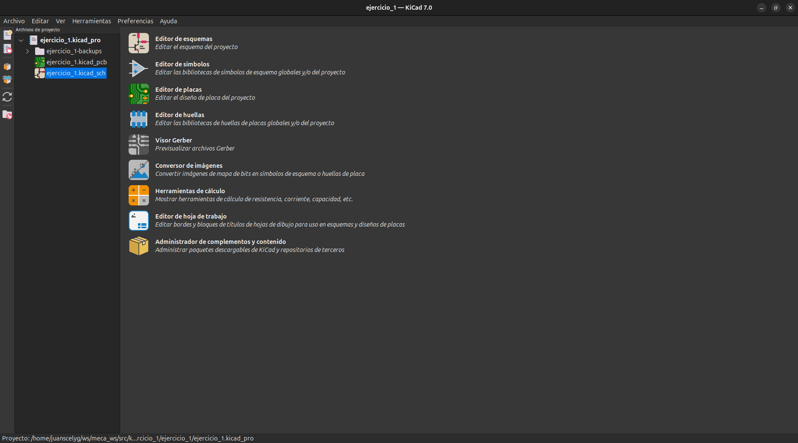

Desde esta ventana podremos editar cualquiera de los esquemas del proyecto creado o cargado.

## Entorno de edición de esquemas

En este entorno podremos editar los esquemas de los circuitos que hemos planteado. Aquí se eligen los componentes con los que vamos a trabajar, tanto sus huellas como sus conexiones. Desde este entorno también podremos acceder a otros editores de elementos. El entorno de edición de esquemas se muestra en la siguiente imagen.

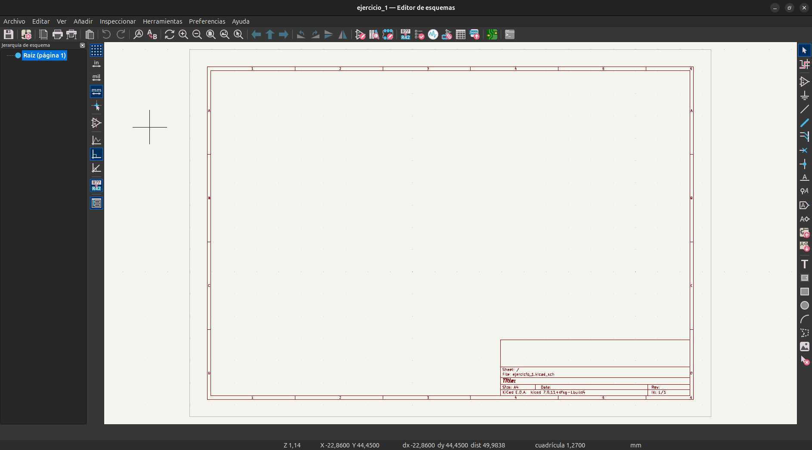

A continuación exploraremos varios componentes de este entorno.

### Edición del cajetín

Para editar el cajetín basta con hacer doble clic sobre él y rellenar la información según corresponda. En él se puede incluir información útil para el equipo de trabajo o de cara a la fabricación. La ventana donde se edita dicha información se muestra a continuación.

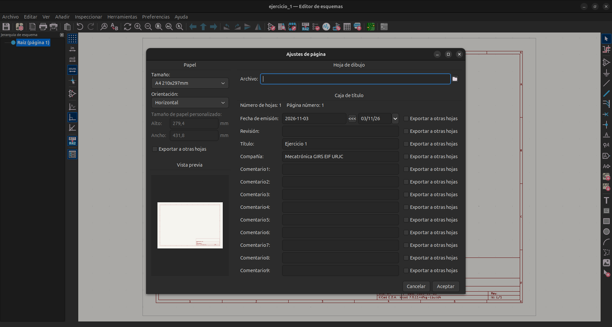

### Añadir símbolos

Para añadir símbolos al diseño actual basta con ir a la barra de la derecha de la interfaz y pulsar el icono con forma de amplificador operacional; también se puede usar el atajo de teclado `A`. Se abrirá la biblioteca de símbolos, donde podremos seleccionar los elementos que queremos añadir a nuestro esquema.

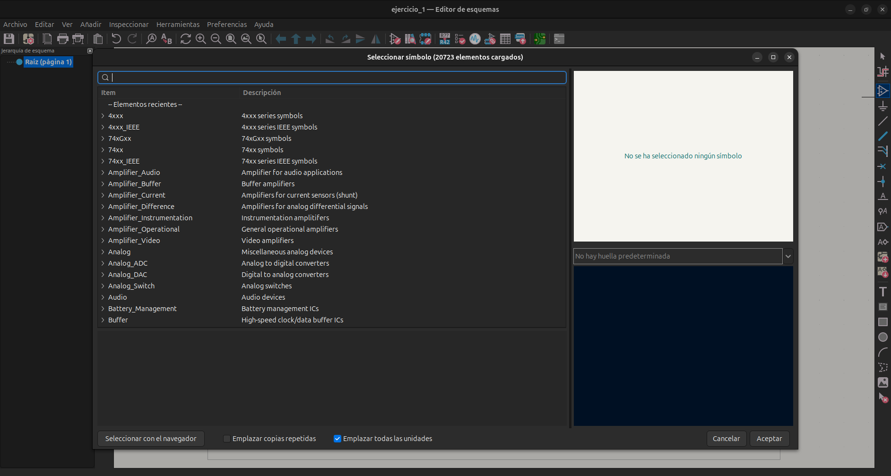

Podemos usar la caja de búsqueda situada en la parte superior de la ventana para buscar la referencia del dispositivo que deseamos añadir. Del mismo modo, al elegir el símbolo del dispositivo, tendremos que elegir una huella asociada a él.

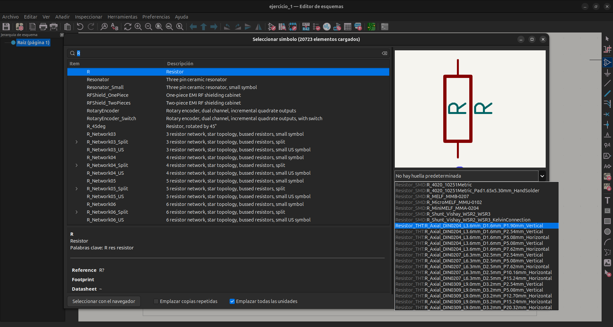

En este punto debemos elegir correctamente la huella de nuestro símbolo, teniendo en cuenta si se trata de un dispositivo SMD, THT o de otro tipo.

### Unión entre símbolos

Para unir símbolos debemos situar el ratón sobre los terminales de los dispositivos que queremos conectar. El cursor cambiará a una línea con un símbolo `+`, lo que indica que podemos unir dichos terminales.

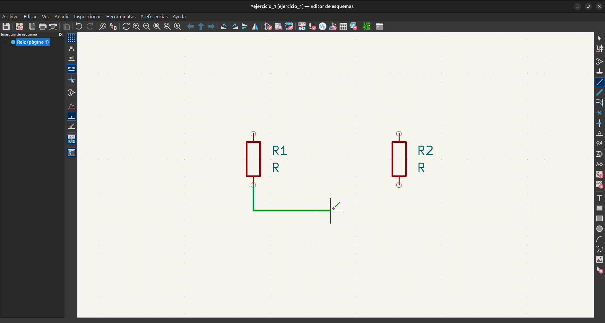

### Añadir símbolos de alimentación

Para añadir un símbolo de alimentación basta con ir a la barra de la derecha del editor de esquemas y pulsar el botón con forma de tierra (`GND`); otra forma es mediante la tecla `P`.

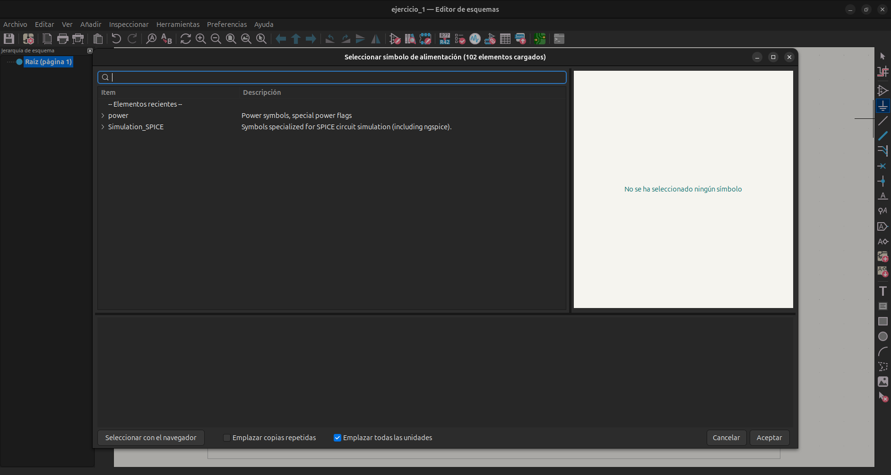

Se debe seleccionar cada uno de los símbolos de alimentación que requiera el diseño, añadiendo tantas fuentes de alimentación como sean necesarias. Además, la alimentación necesitará un componente físico (por ejemplo, un conector) para poder ubicarse en el circuito impreso.

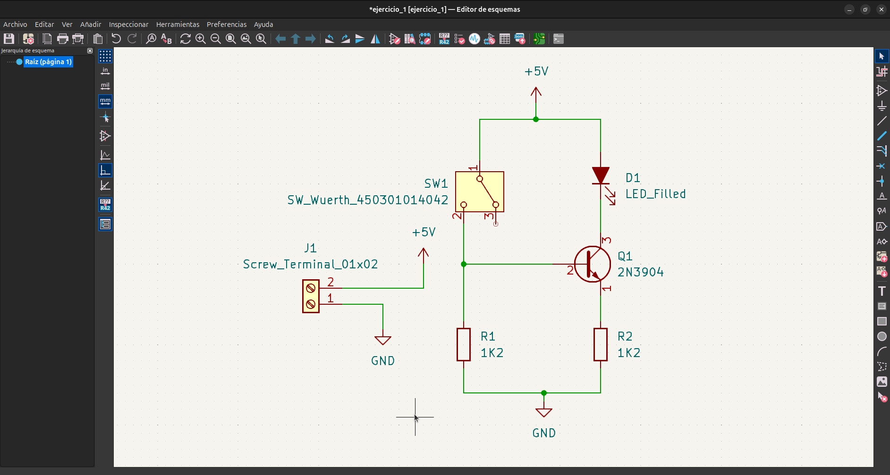

Al añadir los símbolos de alimentación conviene asociarlos a su respectiva huella. Veamos el caso en el que hemos elegido como conector de alimentación el dispositivo `J1 Screw_Terminal_01x02`. Este dispositivo no tiene una huella asociada, por lo que tendremos que añadirla. Para ello haremos doble clic sobre el dispositivo y abriremos su configuración.

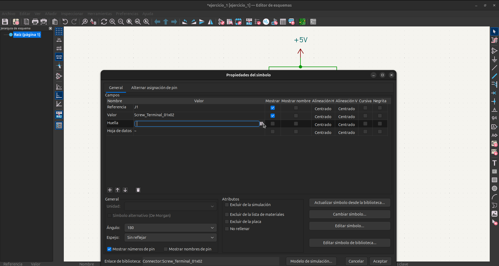

Haremos clic en el campo de la huella, que aún está vacío, e iremos a la biblioteca de huellas, donde buscaremos una que se ajuste a las necesidades del conector que queremos utilizar. En este caso hemos elegido la huella `Connector_JST:JST_EH_S2B-EH_1x02_P2.50mm_Horizontal`, un conector JST de 2 pines con una separación de 2,5 mm en horizontal. Sin embargo, en la imagen podemos observar uno en vertical.

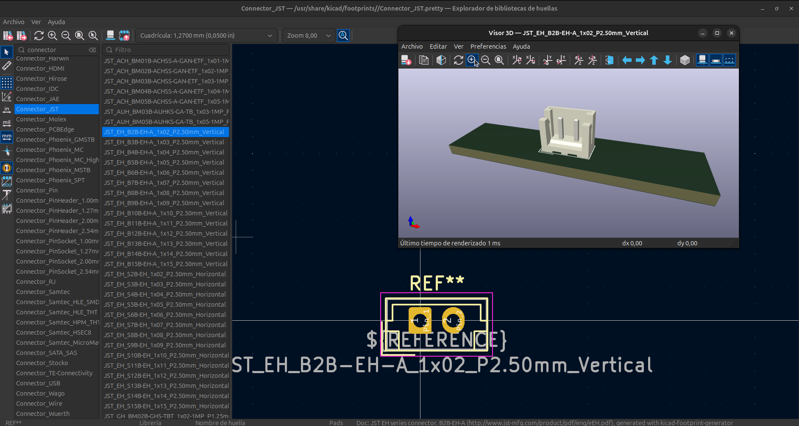

### Modificar la huella de un símbolo

Antes de pasar a la edición del circuito impreso, nos hemos dado cuenta de que el interruptor `SW Wuerth` tiene una huella que no nos conviene para nuestro diseño. Siguiendo el procedimiento descrito anteriormente para los conectores de alimentación, modificaremos la huella de este símbolo: hacemos doble clic sobre él, editamos el campo de la huella y elegimos una nueva de la biblioteca.

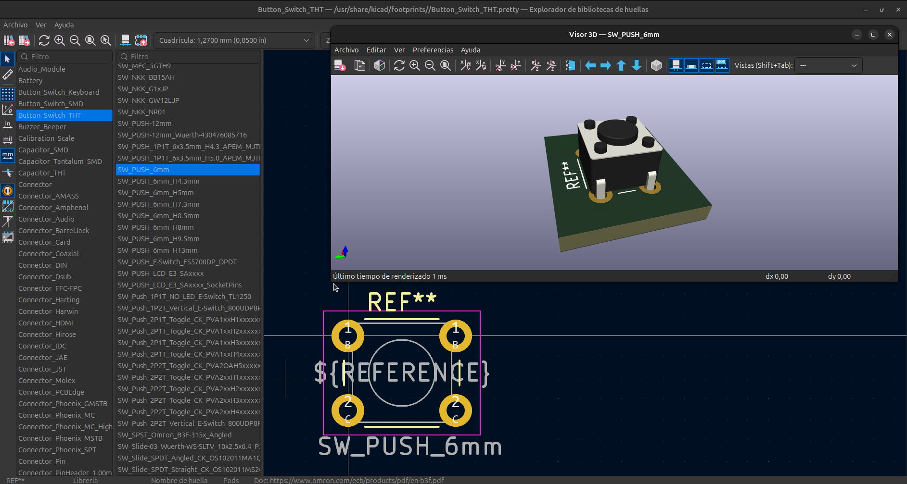

Con esto el esquemático quedaría terminado y podríamos pasar a la edición del circuito impreso.

## Entorno de edición de placas

En este entorno se realiza la edición de las placas. Se puede partir de un diseño esquemático o trabajar con huellas desde cero; evidentemente, lo recomendable es editar la placa a partir de un esquemático previo. Para abrir el editor basta con hacerlo desde la ventana principal del software o, desde el editor de esquemas, pulsar el botón de circuito impreso.

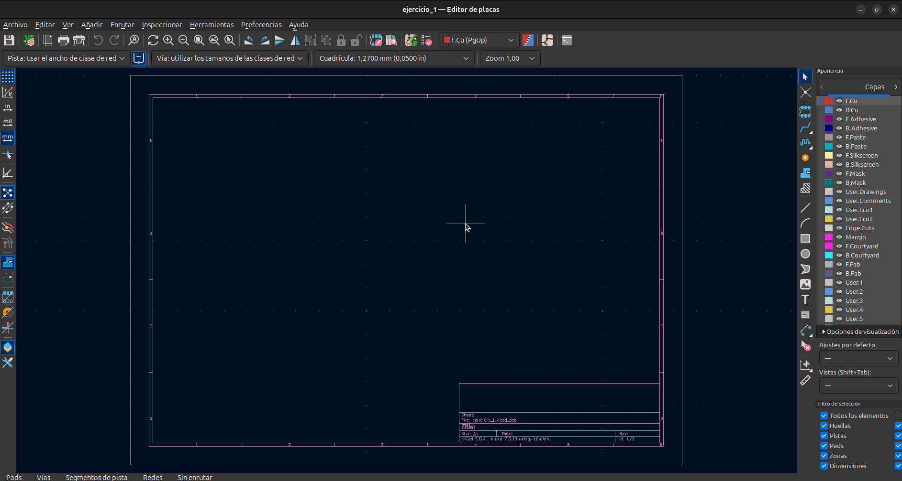

En este entorno se puede editar el cajetín de la misma forma que en el editor de esquemas. A continuación describiremos algunos elementos propios de este entorno:

- **Capas:** podemos gestionar las diferentes capas del diseño desde el panel de la derecha. Para seleccionar una capa concreta usaremos el selector que aparece en la barra de herramientas superior.
- **Reglas de diseño:** aunque el software ofrece muchas ayudas para el trazado de pistas, en la parte superior existe un botón para verificar las reglas de diseño del circuito (DRC).
- **Actualizar desde el esquema:** para no tener que traer las huellas una por una, existe un botón que las importa desde el esquemático asociado al proyecto.

En este entorno de trabajo podremos visualizar:

- **Soldermask:** máscara de soldadura.
- **Silkscreen:** capa de serigrafía.
- **Layout:** el diseño de la placa.
- **Pad:** zona de contacto de un pin.
- **Net:** conexión eléctrica entre dos o más componentes.
- **Rat (ratsnest):** conexión de una net que aún no se ha trazado en el layout.
- **Traza (pista):** conexión de una net que ya se ha trazado en el layout.
- **Vía:** conexión entre capas.

Cada uno de estos elementos dispone de un botón o una herramienta para su diseño o gestión.

> **Nota:** todos los valores por defecto del editor de placas se pueden configurar desde un icono situado a la izquierda de la barra de herramientas, debajo del menú `Archivo`.

### Creación del Edge Cuts

Lo primero que debemos crear es el contorno de nuestra placa. Para ello dibujaremos la geometría deseada con las herramientas de dibujo. No hay que olvidar tener seleccionada la capa `Edge.Cuts` para que dicha geometría se defina como el contorno de la placa.

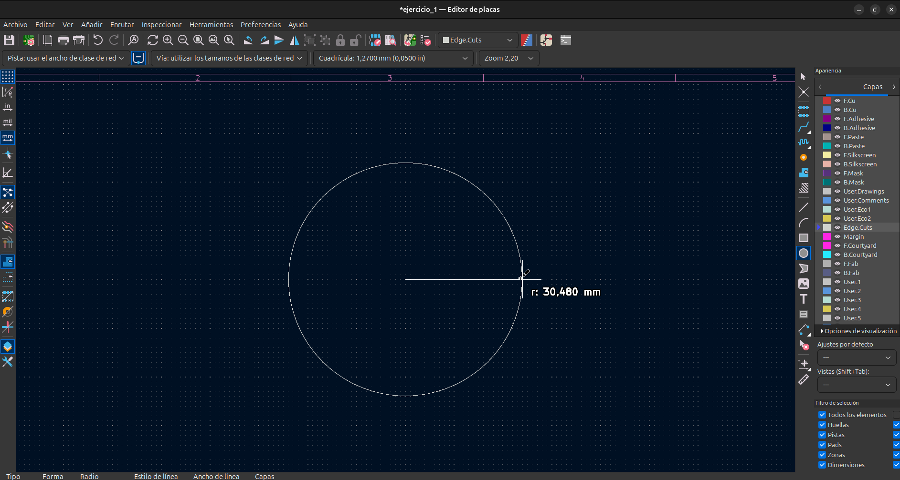

### Traer o actualizar los cambios desde el esquema

Una vez definido el contorno de la placa, traeremos las huellas desde el esquema mediante el botón **Actualizar placa desde esquema** de la parte superior.

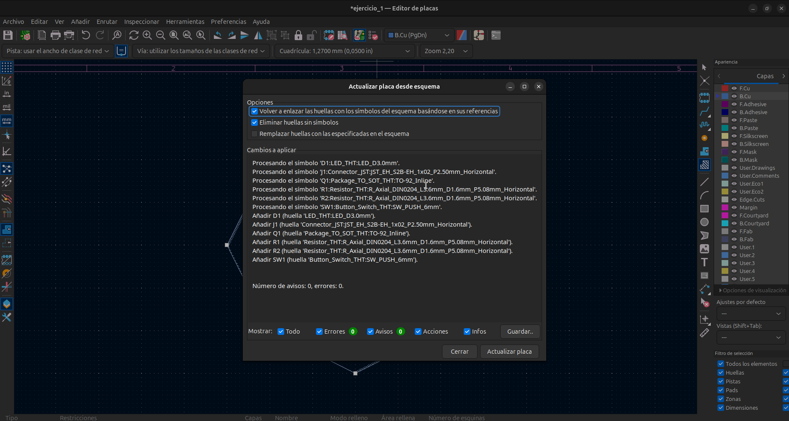

Al traer los cambios desde el esquema se realiza un análisis de los posibles errores. En nuestro caso, uno de los pines del interruptor no está asociado a la huella, un error menor que no altera el funcionamiento del circuito. A continuación podremos ver las huellas importadas.

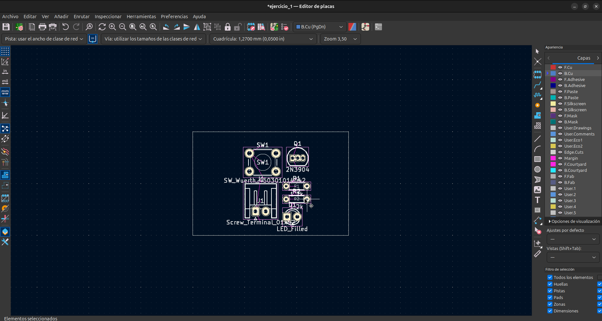

### Definir la zona de relleno

Una buena práctica en el diseño de circuitos impresos es usar zonas de relleno para evitar desbastar material innecesariamente. En la barra lateral derecha está la herramienta de creación de zonas de relleno; seleccionaremos una net (normalmente `GND`) para que todas las rats de esa net se conecten a la zona. Es importante tener seleccionada la capa en la que se va a crear la zona; en nuestro caso, la capa inferior (`B.Cu`, *Bottom Layer*).

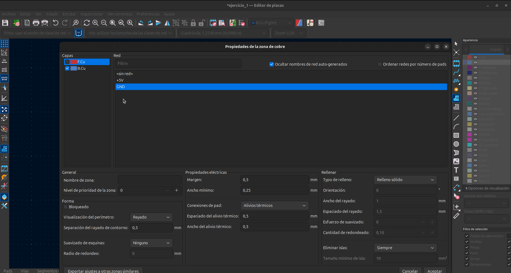

### Ubicación de huellas

En este apartado lo importante es colocar las huellas de manera que no se solapen entre sí. Al traerlas desde el esquemático aparecen agrupadas para reducir el espacio; en este ejercicio las vamos a separar. Ubicamos los componentes como consideremos oportuno.

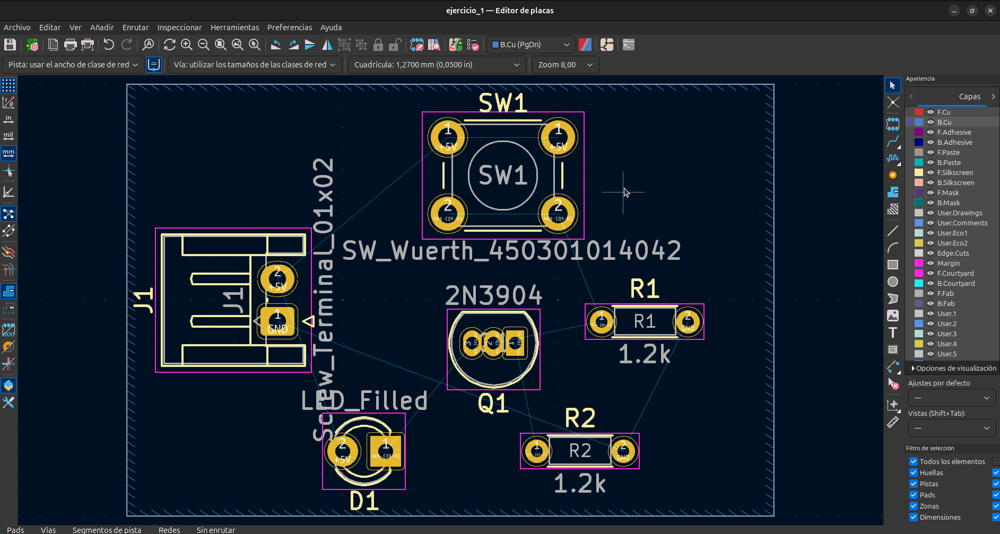

### Añadir agujeros de montaje

Para poder fijar la placa a una base rígida, añadiremos agujeros de montaje. Se encuentran en el catálogo de huellas del panel derecho. En nuestro caso seleccionamos unos para tornillos de 3 mm.

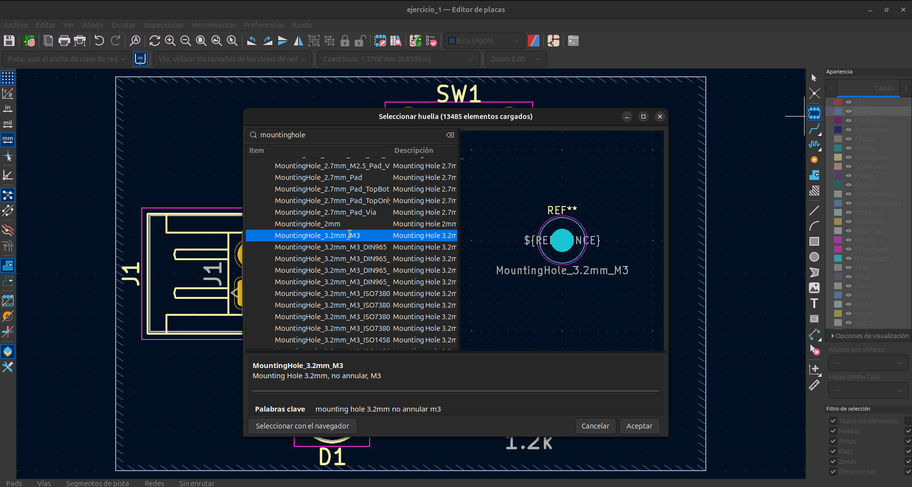

Los ubicaremos según la disponibilidad de nuestro diseño mecánico. Podemos usar herramientas como la regla o la rejilla de fondo. Hay que recordar que dicha rejilla está en milésimas de pulgada (*mils*), que es la unidad en la que están diseñados la mayoría de los dispositivos; si la cambiamos a milímetros podemos tener problemas a la hora de colocar componentes. Para los agujeros de montaje podemos usar la rejilla en milímetros y para los dispositivos eléctricos la rejilla en pulgadas.

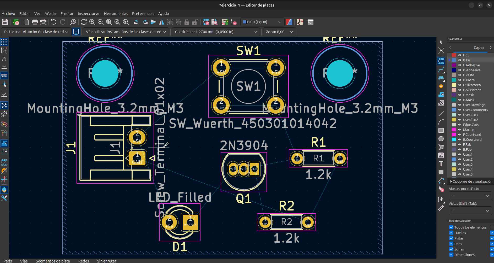

Conviene quitar la serigrafía de los agujeros de montaje para simplificar la capa de silkscreen.

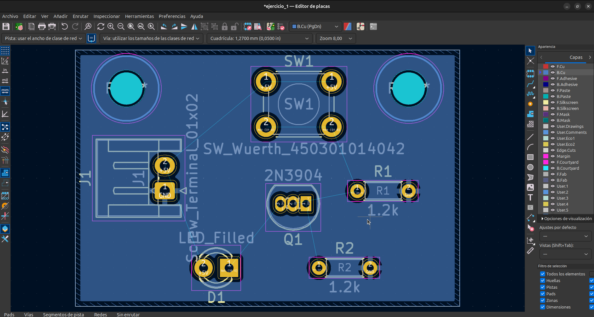

### Ejecutar el DRC

Para verificar que hasta el momento todo va bien ejecutaremos el DRC (*Design Rules Check*) mediante el botón con forma de lista de verificación de la parte superior. En la ventana que se abre pulsaremos `Ejecutar DRC`, lo que validará las reglas de diseño sobre todo lo realizado hasta el momento.

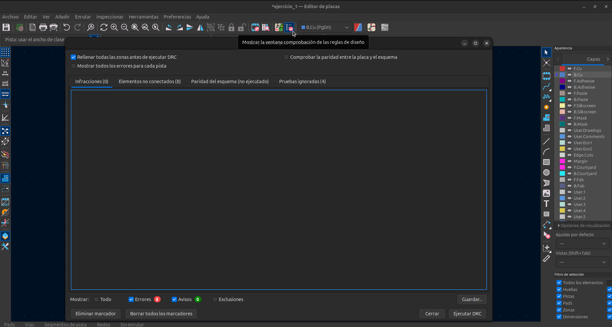

Si todo va bien, veremos que no aparecen errores y que la zona de relleno se ha rellenado. Las rats son visibles, pero aún no hay trazas.

### Enrutado

En este tutorial se muestra un enrutado manual; KiCad también dispone de herramientas de enrutado automático, pero no forman parte de este tutorial. Para enrutar basta con pulsar el botón **Enrutar pistas** del panel derecho o la tecla `X`.

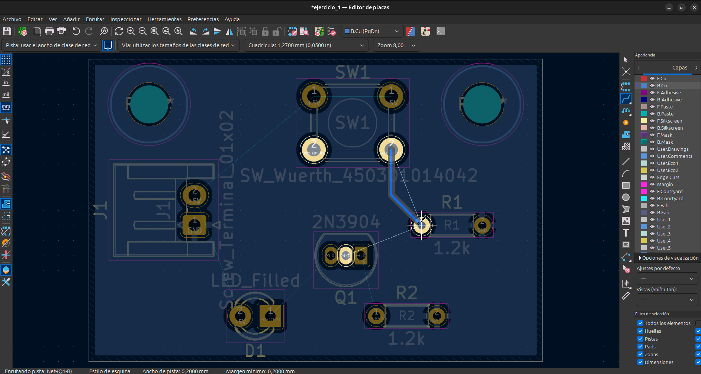

Al terminar el enrutado, la zona de relleno no se visualizará correctamente. Primero nos aseguramos de haber completado todo el enrutado.

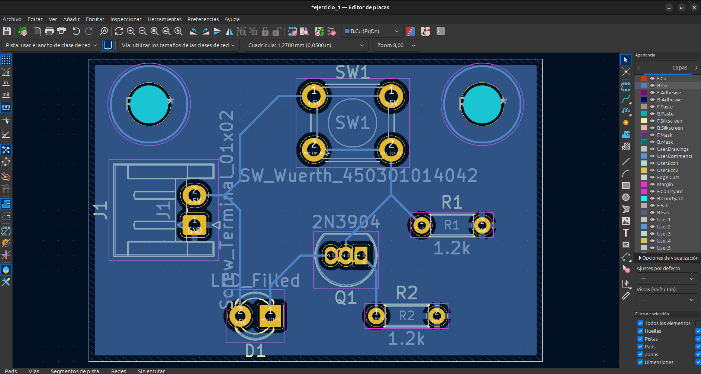

Para que se actualicen las zonas de relleno tendremos que ejecutar de nuevo el DRC, como se ha explicado en la sección anterior (también se puede usar la tecla `B` para rellenar todas las zonas).

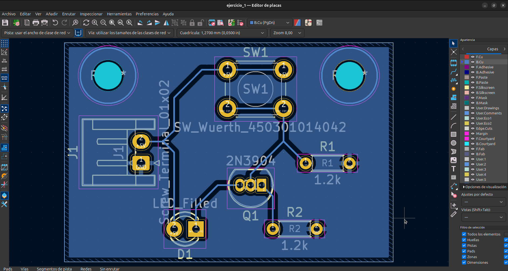

### Visualización 3D

Es posible ver el circuito terminado en 3D desde el menú `Ver` → `Visor 3D`, o con la combinación de teclas `Alt+3`.

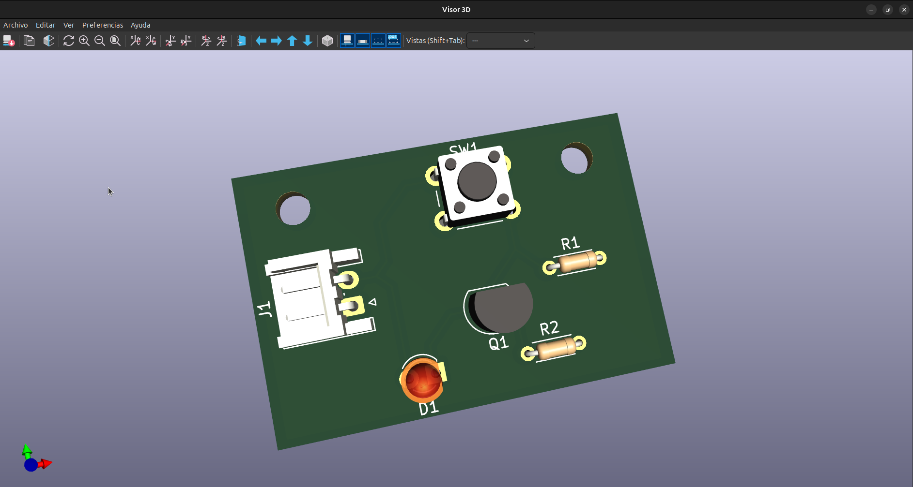

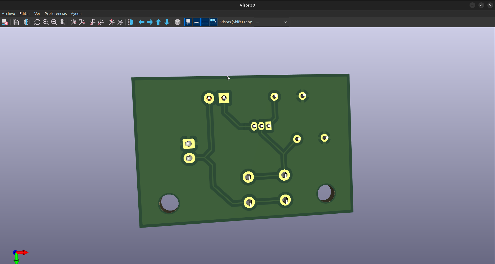

El modelo se puede exportar a formato `STEP` desde el menú `Archivo` → `Exportar`, seleccionando dicho formato. Este archivo se puede importar en FreeCAD para editarlo o usarlo en otro diseño.

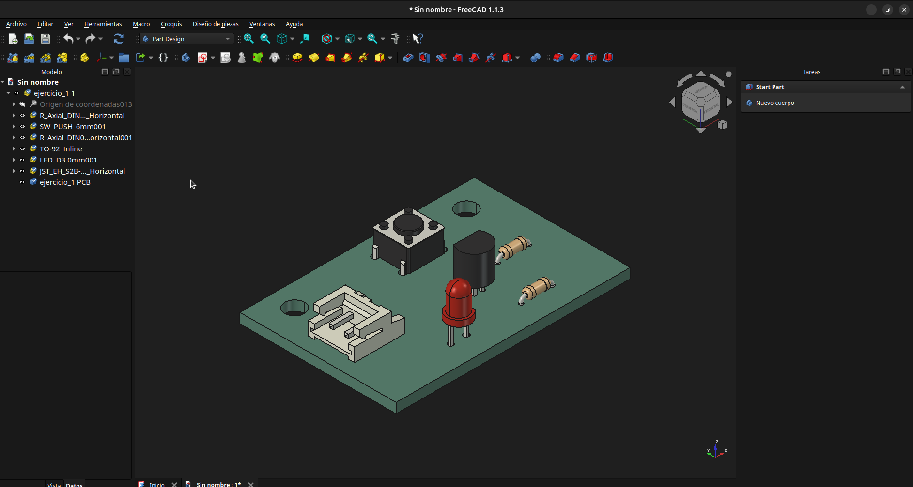

### Envío a fabricación

Para generar los archivos de fabricación, desde el menú `Archivo` seleccionamos `Salidas de fabricación` → `Gerbers`. Los archivos generados son los que enviaremos al fabricante.
